# GoogleSlacking

A fast Google Chat client in the style of Slack (PWA, then desktop and mobile). It's an internal Netmedia tool that other companies can run as their own internal tool.

```
Google Chat API ──┐
Workspace Events API → Pub/Sub → PubSubPullWorker ─→ SQL cache (multi-tenant)
                                                  ├→ SignalR /hubs/chat → clients
                                                  ├→ NotificationService (Slack rules) → Web Push (VAPID)
                                                  └→ TimersWorker: scheduled messages, reminders
ASP.NET Core (BFF): Google OAuth, refresh tokens (Data Protection), REST /api, serves the PWA
React PWA: IndexedDB cache → instant start, optimistic sending, service worker push, Ctrl+K
```

## Design

Netmedia brand (from netmedia.agency): Plus Jakarta Sans (headings, 800) + Inter (text), self-hosted via `@fontsource-variable` (works offline in the PWA). Accent `#db363f` / on dark `#ff5a63`, dark `#171b1f`, warm neutrals `#fcfaf7` / `#f4f1e8`, pill buttons, "eyebrow" section headings. Tokens are in `web/src/styles.css` (`:root`), the logo is in `web/src/brand.tsx`, the app icon is `web/public/icon.svg`.

## What it does (vs. the official Google Chat)

| Area | Features |
|---|---|
| Notifications | Web Push even when the app is closed; Slack rules (DMs: all, spaces: mentions + keywords + threads you take part in); per-conversation All/Mentions/Nothing + mute; Do Not Disturb schedule + pause; no push to the phone while you're active on the desktop; Activity feed |
| Messages | @mentions with autocomplete (+ @all), edit (↑) / delete, reactions with a picker (yours highlighted), attachments (button, paste, drag & drop, image preview), formatting toolbar (bold, italic, strike, code, quote), link previews, quote, forward, copy link |
| Navigation | Ctrl+K, search with filters (`in:` `from:` `after:` `has:link` `is:thread`…), "New" line + opens at the first unread, Esc / Shift+Esc mark as read, Alt+↑/↓, unread synced with the official clients |
| Organisation | Custom sidebar sections (drag & drop), star, mute, new DM / group / space, add members, status + presence (active/away) |
| Beyond Google Chat | Read receipts (reciprocal opt-in, app users only), "… is typing" (app users), scheduled messages, "Later" + reminders, drafts synced across devices, pinned messages and bookmarks in spaces (visible to app users) |
| Not possible (API) | Typing and read receipts for people who don't use the app (official Google Chat), huddles (Meet link only) |

## Screenshots

| Conversation (mentions, reactions, "New" line, previews) | Thread |
|---|---|
| 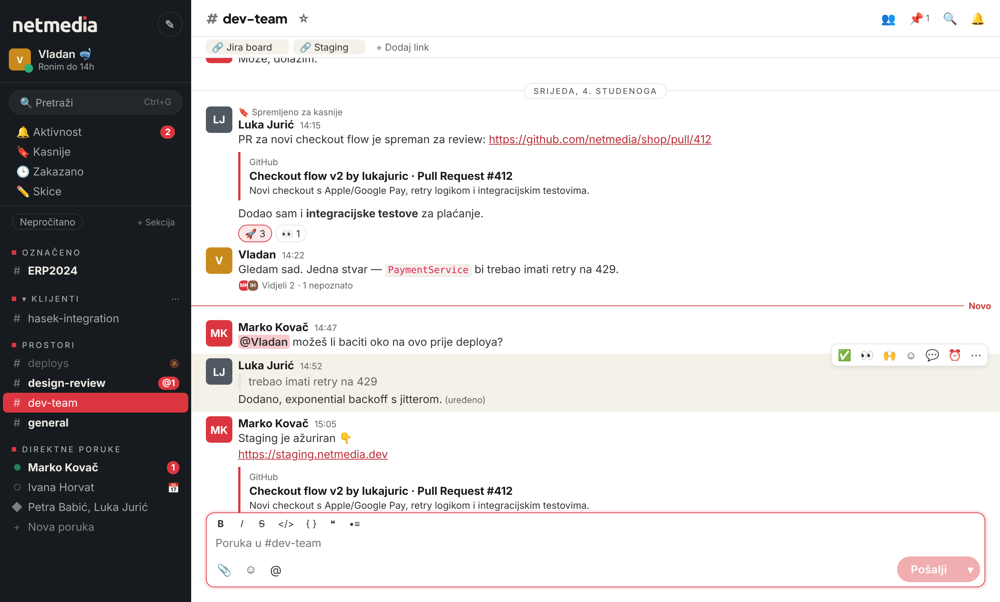 | 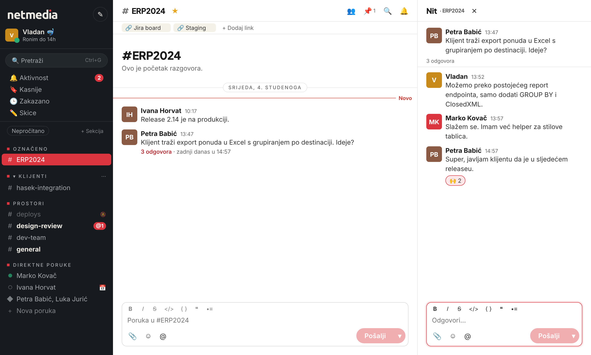 |
| **Activity** | **Later (saved, scheduled, drafts)** |
| 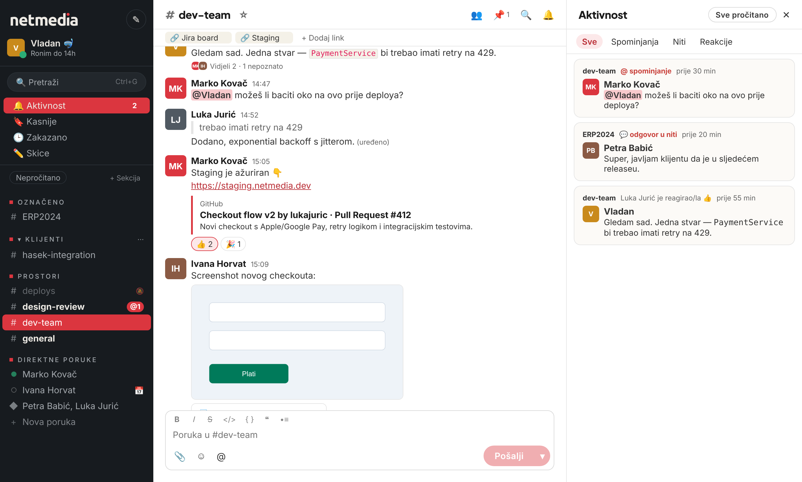 | 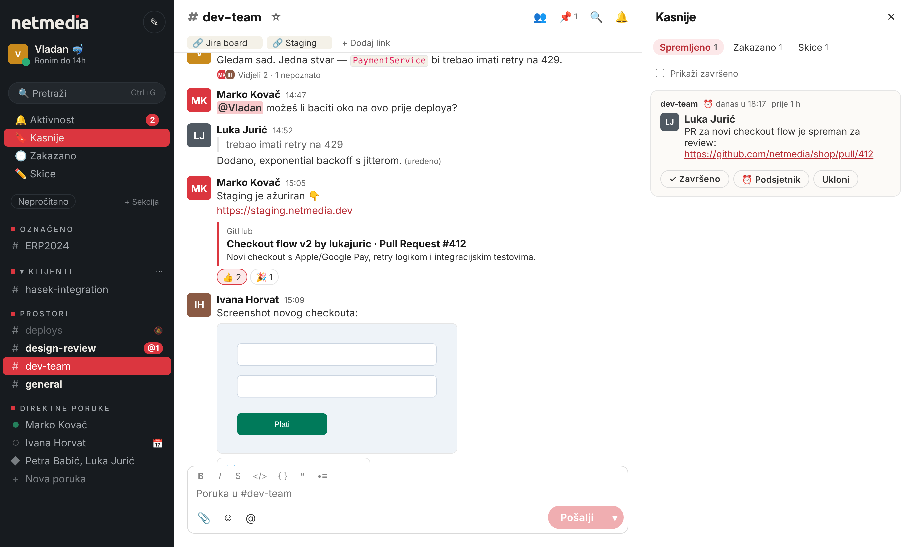 |
| **Message actions** | **@mentions** |
| 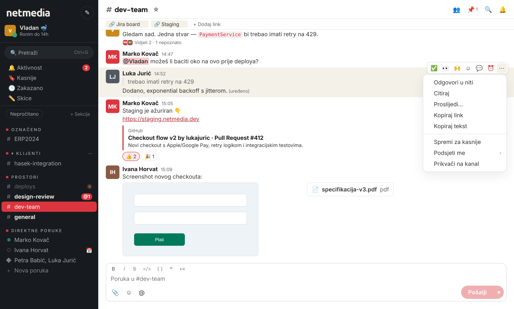 | 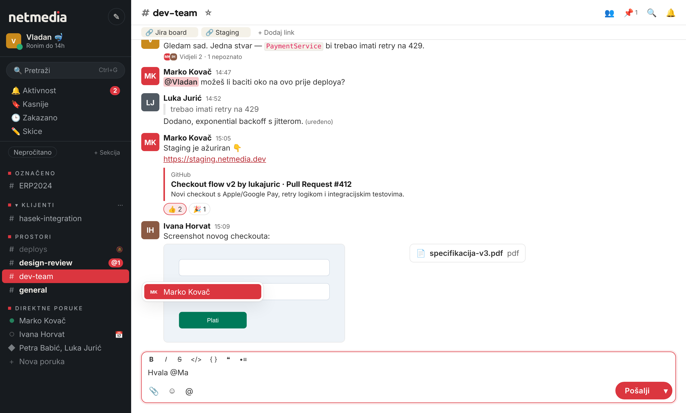 |
| **Search** | **Settings (notifications, DND, status)** |
| 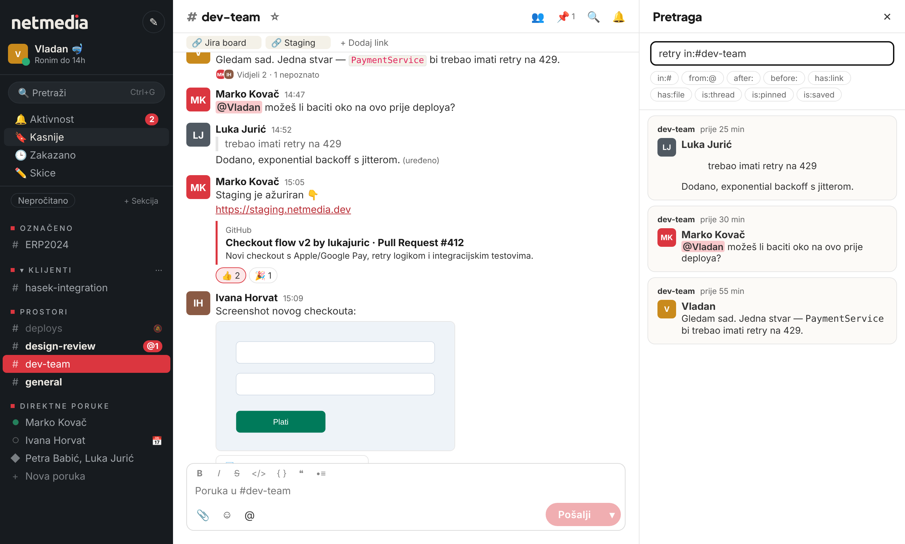 | 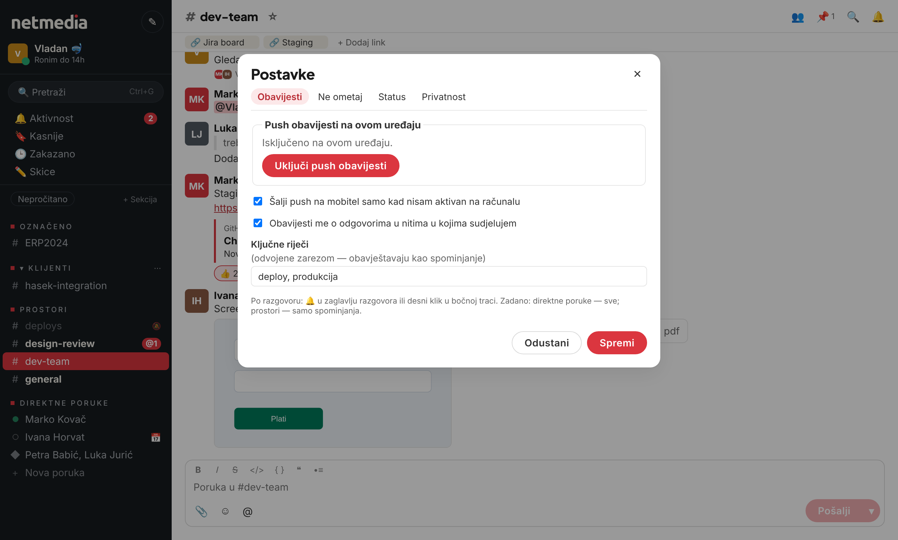 |
| **Read receipts (DM)** | **Read receipts — settings** |
| 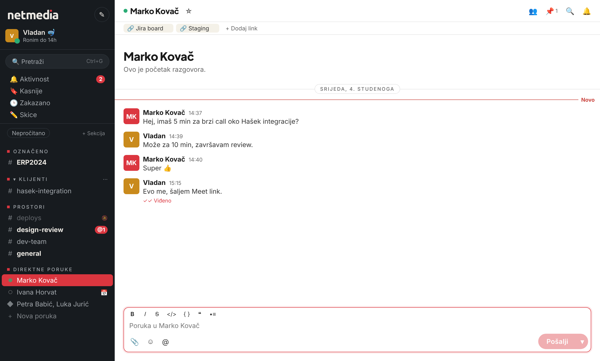 | 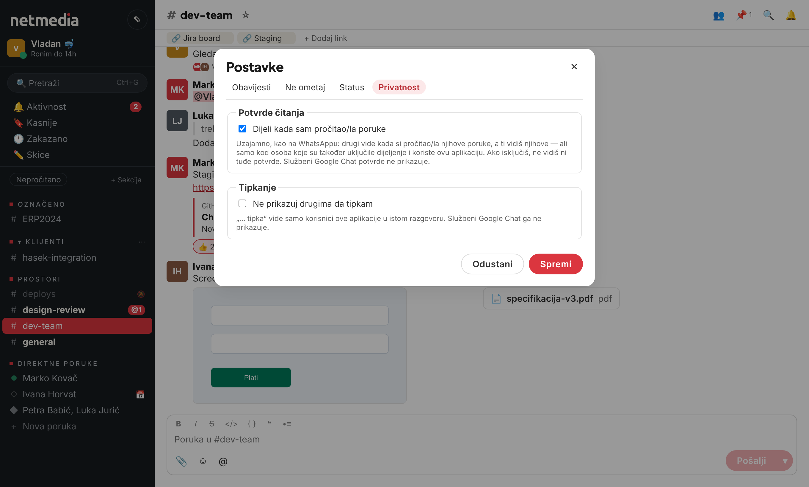 |
| **„… tipka”** | |
| 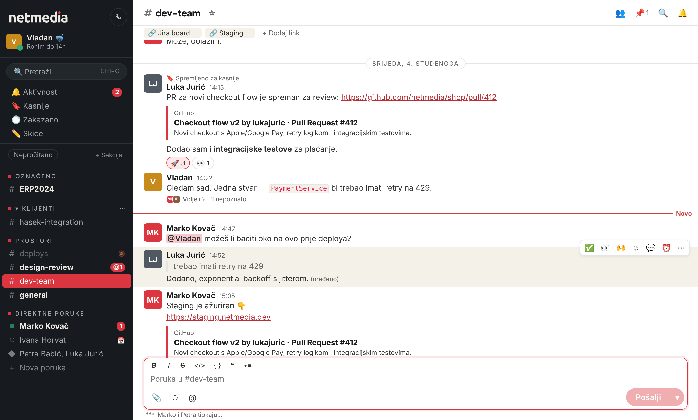 | |
| **Quick switcher (Ctrl+K)** | **Dark mode** |
| 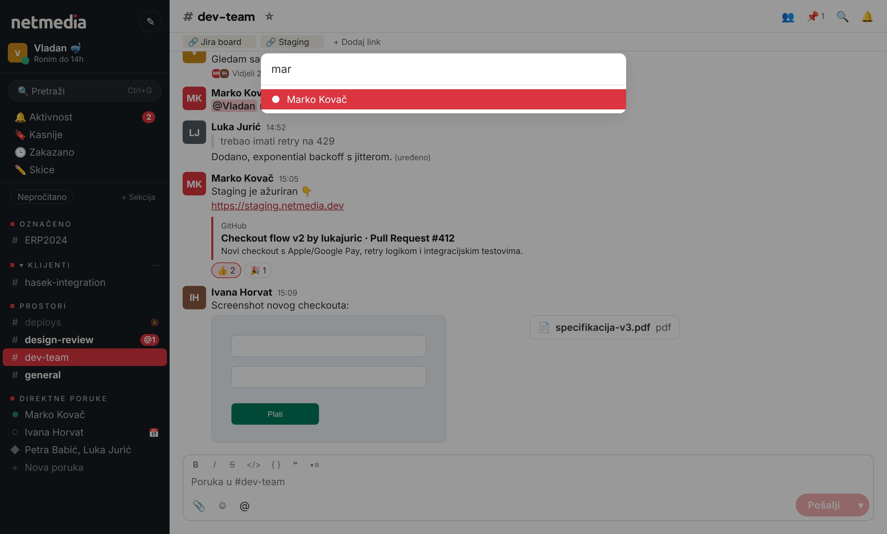 | 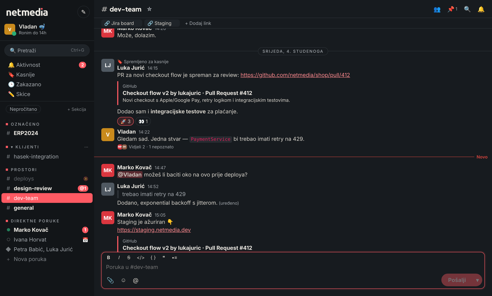 |

| Mobile — list | Mobile — conversation | Sign-in |
|---|---|---|
| 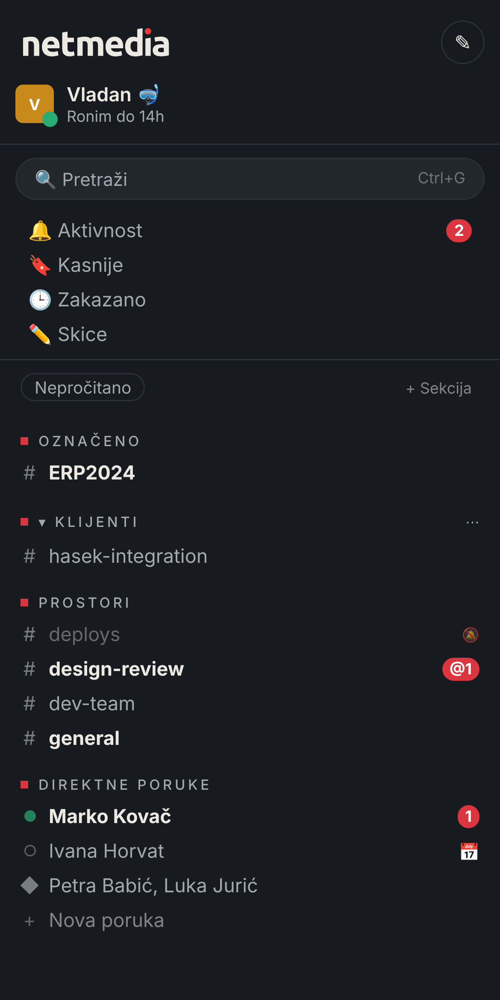 | 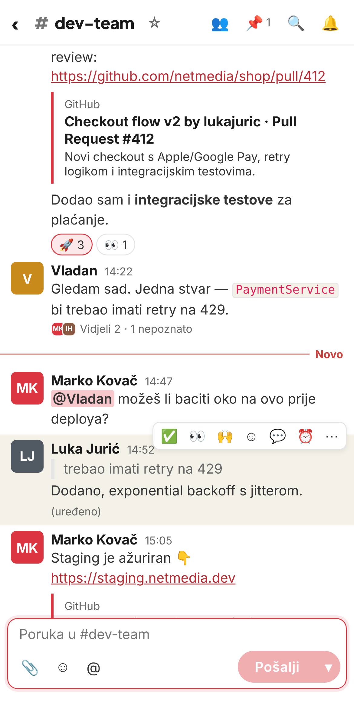 | 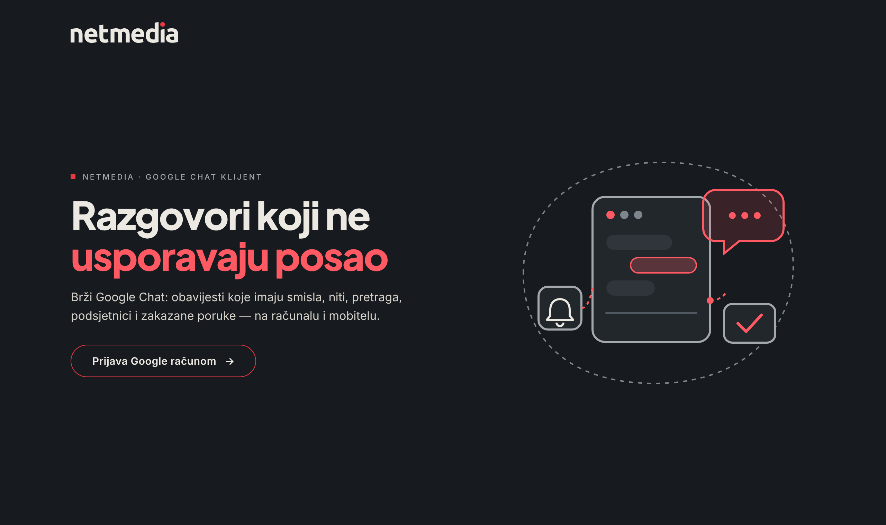 |

The data is fictional (mocked API). To regenerate: `web/scripts/screenshots.cjs`.

## Structure

| Folder | What it contains |
|---|---|
| `src/GoogleSlacking.Domain` | Entities (Tenant, AppUser, Space, SpaceMember, Message, Person, EventSubscription) |
| `src/GoogleSlacking.Google` | Hand-written REST clients: Chat, Workspace Events, People, Pub/Sub, OAuth. No Google SDK dependency |
| `src/GoogleSlacking.Core` | Pure logic with no NuGet packages: Web Push (RFC 8291 + VAPID), notification rules, search syntax, link previews (SSRF-safe) |
| `src/GoogleSlacking.Infrastructure` | EF Core (SQL Server), tenant filter, token store, sync, event processing, background workers |
| `src/GoogleSlacking.Api` | Minimal API, Google sign-in, SignalR hub, SPA hosting |
| `tests/GoogleSlacking.Tests` | xUnit + SQLite in-memory; see `ApiTestCatalog.md` |
| `web/` | Vite + React + TS PWA |
| `docs/` | `google-setup.md` (GCP/Workspace setup), `architecture.md` |

## Running locally

Prerequisites: .NET 10 SDK, Node 22+, SQL Server LocalDB, and a configured GCP project (see [docs/google-setup.md](docs/google-setup.md)).

```powershell
# 1. Secrets (shared UserSecretsId for the whole solution; they live outside the repo)
cd src/GoogleSlacking.Api
dotnet user-secrets set "Google:ClientId" "<client-id>.apps.googleusercontent.com"
dotnet user-secrets set "Google:ClientSecret" "<secret>"
dotnet user-secrets set "Google:ProjectId" "<gcp-project-id>"
dotnet user-secrets set "Google:ServiceAccountKeyPath" "C:\\secrets\\googleslacking-pubsub.json"

# 1b. Web Push (VAPID) — generates keys and prints the commands to store them
dotnet run -- --generate-vapid

# 2. Database (the first migration)
dotnet tool install -g dotnet-ef   # if you don't have it
cd ../..
dotnet ef migrations add Initial -p src/GoogleSlacking.Infrastructure -s src/GoogleSlacking.Api

# 3. API (http://localhost:5080). In Development it migrates the DB itself and seeds tenants from appsettings.Development.json
dotnet run --project src/GoogleSlacking.Api

# 4. Web (http://localhost:5173, proxies /api, /auth and /hubs to the API)
cd web
npm install
npm run dev
```

Open http://localhost:5173, sign in, and the first sync starts in the background. With no Pub/Sub set up, set `Sync:EnablePubSub=false`. Everything works except real-time updates.

Production: `npm run build:api` builds the PWA into `src/GoogleSlacking.Api/wwwroot`, and the API serves everything from one origin.

## Key decisions

- **Tenant = Workspace domain** (the OIDC `hd` claim). An EF global query filter on every `ITenantOwned` entity, and `SaveChanges` blocks cross-tenant writes.
- **Reads come from the local cache.** Google is called only for backfill ("load older"), sending, and read state. The project quota is 3000 message reads per minute for all tenants combined.
- **One subscription per user** on `//chat.googleapis.com/spaces/-`. The same event arrives once per member, so upsert is idempotent and only real changes are broadcast.
- **Subscriptions with resource data expire within a few hours.** `SubscriptionMaintenanceWorker` renews them, and expirationReminder events trigger renewal too.
- **Sender names:** with user auth the Chat API doesn't return `displayName`, so the People API resolves them (`directory.readonly`) and they're cached in `People`.
- **Refresh tokens** are protected with ASP.NET Data Protection. The key ring is in the DB; for production add Key Vault protection.

## TODO (next steps)

- [ ] Tauri (desktop) and Capacitor (mobile, native push via FCM/APNs) wrappers
- [ ] SQL Server Full-Text Search instead of LIKE (for large tenants; LocalDB doesn't support FTS)
- [ ] Custom emoji (picker + rendering), Google Drive attachments from the picker
- [ ] Sync sidebar sections with the Google Chat Sections API
- [ ] Thread read state (threadReadState events) and an "unread threads" view
- [ ] Self-hosted package: Dockerfile + Bicep (Azure Container Apps + Azure SQL + Key Vault)
- [ ] Scale-out: Azure SignalR + presence in Redis, Pub/Sub dead-letter topic, OpenTelemetry
